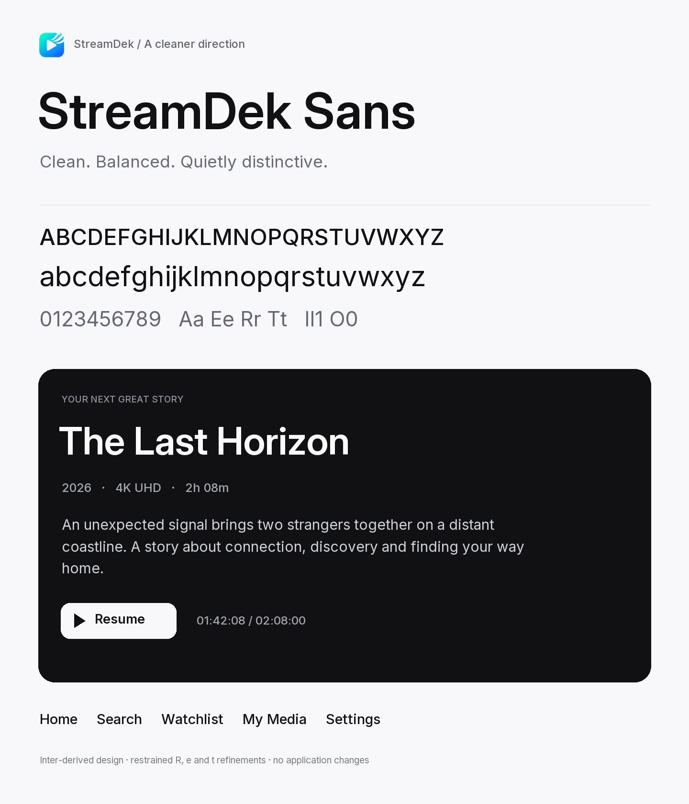
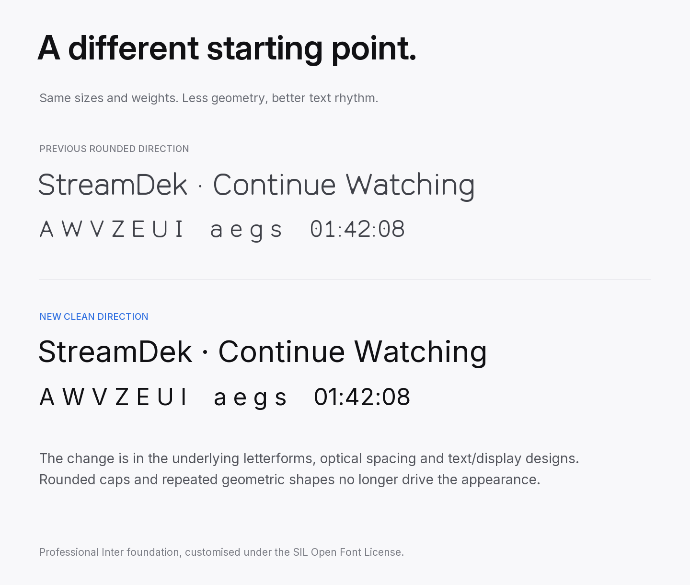
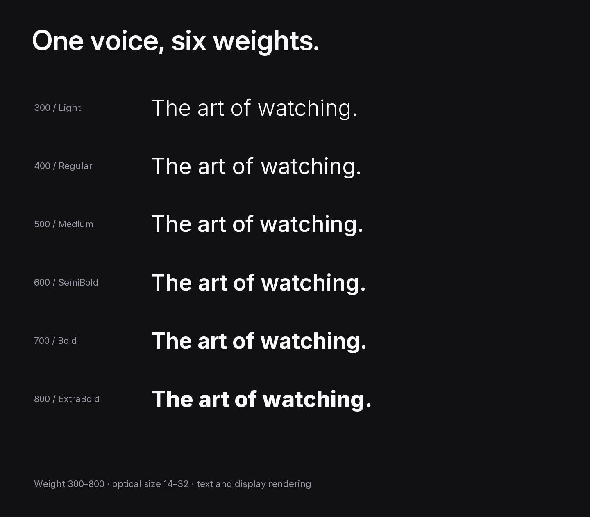
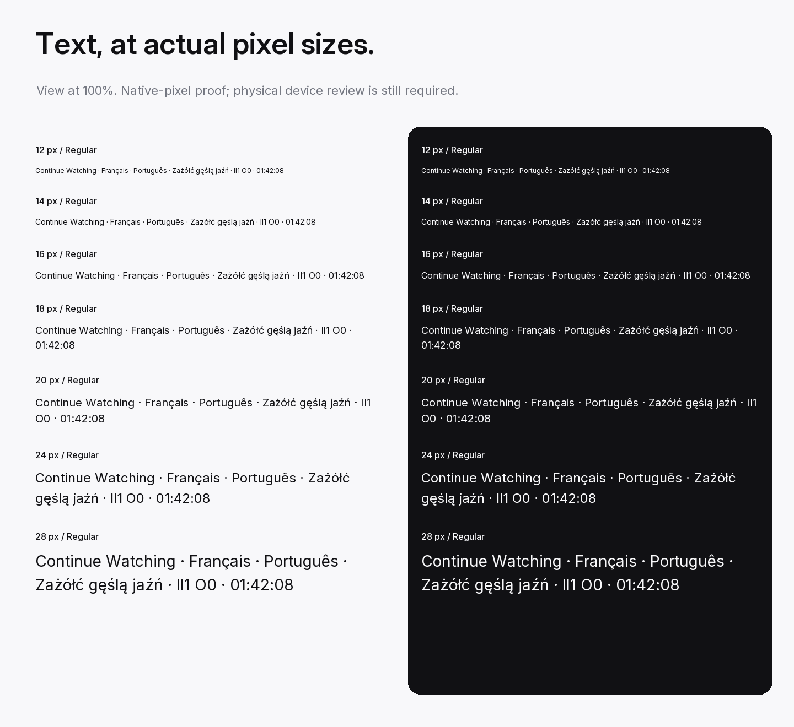
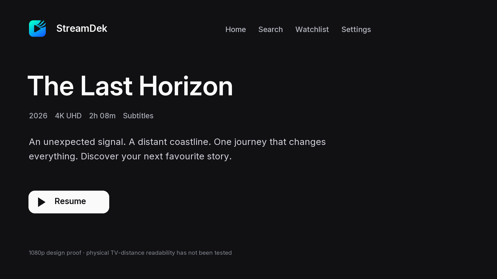

# StreamDek Sans — Clean edition 0.920

A restrained customisation of Inter 4.1 for the cleaner, iOS-like direction selected for StreamDek. Most letterforms remain Inter. The R, e and t have small documented outline changes; spacing, kerning, broad language coverage and text/display optical sizing are inherited from the professional foundation.

**[Browse the clean direction interactive specimen](https://raw.githack.com/StreamDek/StreamDek-Sans/main/StreamDek-Clean-Direction/index.html)** — try your own text, adjust weight and size, switch between light and dark, and browse the design proofs. The rendered preview is served through raw.githack from this public repository.

[View the HTML source](StreamDek-Clean-Direction/index.html) · [Download the clean edition](StreamDek-Sans-Clean-v0.920.zip)

To browse locally, open `StreamDek-Clean-Direction/index.html` after cloning or downloading the repository, keeping its adjacent fonts and specimens folders intact.

## Visuals

### Clean direction

### Direction comparison

The previous rounded proposal alongside the clean edition.

### Six weights

### Small text

### TV proof

## Deliverables

- Six weights: Light 300, Regular 400, Medium 500, SemiBold 600, Bold 700, ExtraBold 800, each in TTF, true CFF OTF and WOFF2.
- Variable TTF and WOFF2: weight 300–800, optical size 14–32.
- Four supplementary display TTFs: Regular, Medium, SemiBold and Bold, optical size 32. Main static files use optical size 14.
- 2,852 mapped Unicode characters and 2,937 glyphs, including inherited alternates and accented forms.
- Five rendered specimens, browser screenshots, validation evidence, build scripts and the original Inter variable source.

## Rebuild

From the `StreamDek-Clean-Direction` directory, use Python 3 with fonttools 4.66.1, brotli 1.2.0, Pillow and uharfbuzz 0.56.3 installed in the active environment. Run `python sources/build_clean.py`, then `python sources/proof_clean.py`. The included official `references/InterVariable.ttf` is the editable variable-outline foundation; `sources/build_clean.py` specifies every custom point offset. The scripts also support the original adjacent `font-build-deps` directory when present.

`validate_clean.py` includes locale checks against the original local StreamDekMobile checkout; adapt that path if running elsewhere. `browser-qa.cjs` requires Playwright and Microsoft Edge; adapt its executable path for another machine.

See the [font license](StreamDek-Clean-Direction/OFL.txt), [design notes](StreamDek-Clean-Direction/docs/DESIGN.md), [integration guide](StreamDek-Clean-Direction/docs/INTEGRATION.md) and [validation report](StreamDek-Clean-Direction/docs/VALIDATION.md).
